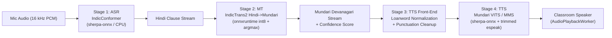
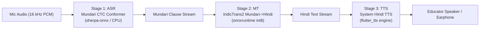
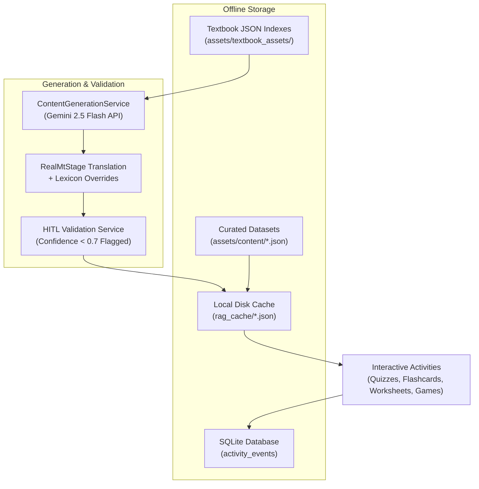

# AYOVAANI (ayo_vani)

AYOVAANI is an on-device, offline multilingual educational assistant and classroom translation platform designed for primary school educators in tribal regions of India. It bridges English/Hindi classroom curricula and mother-tongue Mundari using edge machine learning models (ASR, MT, and TTS) running locally on Android devices without internet connectivity.

---

## 1. System Pipeline Architecture

AYOVAANI supports bidirectional on-device speech-to-speech translation with sub-second clause streaming and HITL (Human-In-The-Loop) teacher review.

### Direction A: Teacher Speech (Hindi -> Mundari)



### Direction B: Student Speech (Mundari -> Hindi)



### RAG & Offline Content Architecture



---

## 2. Hardware & Device Requirements

Due to resident on-device neural network execution, target mobile devices must meet the following hardware profile:

- **Target ABI Architecture:** `arm64-v8a` (64-bit ARM architecture). 32-bit `armeabi-v7a` and `x86` are unsupported due to quantized ONNX dynamic library requirements.
- **System RAM:** $\ge 3$ GB RAM recommended ($\ge 2$ GB absolute minimum). The resident IndicTrans2 MT encoder/decoder graphs (~317 MB), IndicConformer ASR graph (~188 MB), and MMS-TTS graph (~31 MB) require sufficient headroom to prevent Android Low Memory Killer (LMK) eviction.
- **Internal Storage:** $\ge 1$ GB free storage for pre-bundled ONNX model graphs, textbook resources, and SQLite activity logs.
- **Android OS:** Android 7.0 (API Level 24) or newer.

---

## 3. Pulling Large Model Files (Git LFS)

The quantized ONNX neural weights and SentencePiece vocabularies are version-controlled via Git LFS:

```bash
# 1. Install Git LFS on your workstation
git lfs install

# 2. Clone the repository and fetch LFS binaries
git lfs pull
```

Verify that the following binary assets are un-stubbed and present:
- `assets/models/model.int8.onnx` (~188 MB)
- `assets/models/mt/model_int8.onnx` (~158 MB)
- `assets/models/mt/decoder_model_int8_argmax.onnx` (~158 MB)
- `assets/models/asr_mundari/mundari_stt_ctc.int8.onnx` (~134 MB)
- `assets/models/tts/mundari.onnx` (~30 MB)

---

## 4. Running and Building with `--dart-define`

API keys and backend server endpoints are provided securely at compile time or run time using `--dart-define`.

### Development Mode

```bash
flutter run \
  --dart-define=GEMINI_API_KEY="YOUR_GEMINI_API_KEY" \
  --dart-define=GEMINI_MODEL="gemini-2.5-flash" \
  --dart-define=BACKEND_BASE_URL="https://api.ayovaani.org"
```

### Production Release APK Build

```bash
flutter build apk --release \
  --dart-define=GEMINI_API_KEY="YOUR_GEMINI_API_KEY" \
  --dart-define=GEMINI_MODEL="gemini-2.5-flash" \
  --dart-define=BACKEND_BASE_URL="https://api.ayovaani.org"
```

### Configuration Parameters

| Parameter | Required | Default | Description |
|---|---|---|---|
| `GEMINI_API_KEY` | Optional | `""` | Google Gemini API key for offline curriculum content generation. When unset, curated local content is used. |
| `GEMINI_MODEL` | Optional | `gemini-2.5-flash` | Gemini model endpoint name. |
| `BACKEND_BASE_URL` | Optional | `""` | Optional endpoint URL for syncing consented audio training logs and HITL teacher edits. |

---

## 5. Automated Regression & Evaluation Harness

### Machine Translation Quality (chrF++ and BLEU)

Translate the standard 100-sentence evaluation corpus (`test/fixtures/demo_corpus_100_sentences.json`) on an attached Android device:

```bash
# Run on-device MT evaluation integration test
flutter test integration_test/mt_eval_test.dart

# Retrieve generated CSV from device and score with SacreBLEU
python3 tool/score_mt.py mt_eval_results.csv
```

### ASR Speech-to-Text Smoke Test

Verify that the IndicConformer offline ASR engine transcribes real 16 kHz classroom speech:

```bash
flutter test integration_test/stt_smoke_test.dart
```

### Verification Test Suite

Run the full unit and widget test suite:

```bash
flutter test
```

---

## 6. Curated Content Precedence Hierarchy

AYOVAANI implements a 3-tier content hierarchy:
1. **Tier 1 (Curated Content):** Pre-packaged, pedagogue-verified JSON datasets in `assets/content/` (`curated_chapter_dictionary.json`, `curated_english_activities.json`, `curated_balvatika.json`, `curated_teacher_practice.json`).
2. **Tier 2 (Cached Generated Content):** Local on-device cache (`rag_cache/`) preserving previously generated extensions.
3. **Tier 3 (Runtime Generation / MT):** Real-time generation through `RealMtStage` and Gemini Flash fallback.
